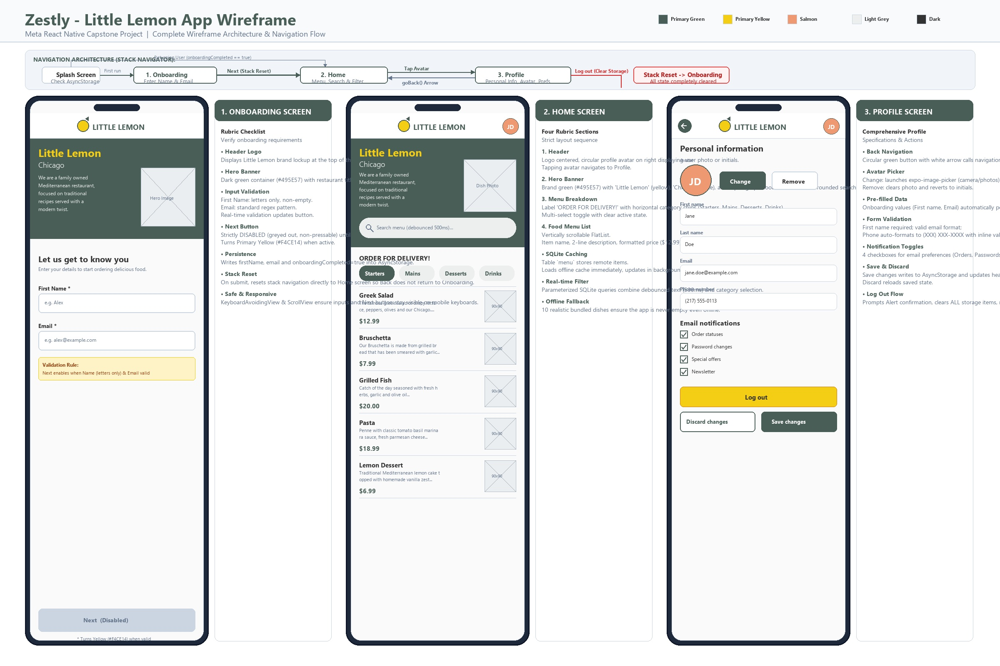

# Zestly: Little Lemon Food Ordering App

A modern, responsive, offline-first food ordering mobile application for the restaurant **"Little Lemon"**, built as the Meta React Native Capstone Project (Coursera).



---

## 📖 Project Overview

**Zestly** is a React Native mobile application built on the Expo framework for "Little Lemon", a charming Mediterranean restaurant based in Chicago. The app delivers a seamless ordering experience with real-time validated onboarding, a customizable user profile, and an interactive home menu with category filtering, instant debounced search, and robust SQLite offline caching.

---

## ✨ Features

- **Branded Design System**: Authentic Mediterranean brand aesthetics using Little Lemon colors (Primary Green `#495E57`, Primary Yellow `#F4CE14`, Secondary Salmon `#EE9972`) and Google Fonts (**Markazi Text** for serif headings and **Karla** for body copy and UI elements).
- **Interactive Wireframe**: High-resolution visual wireframe and architecture flow diagram generated with Python Pillow (`wireframe/zestly-wireframe.jpg`).
- **Guarded Onboarding Flow**:
  - Live client-side validation for First Name (letters only, min 1 character) and Email (regex).
  - Next button is disabled and greyed out until inputs meet valid criteria.
  - Automatically persists user state to `@react-native-async-storage/async-storage` and resets navigation stack directly to Home.
- **Home Screen Architecture**:
  - **Header**: Centered Little Lemon logo with circular user avatar on the right (photo or fallback initials badge) navigating directly to Profile.
  - **Hero Banner**: Chicago location, restaurant bio, appetizing dish image, and live search bar.
  - **Menu Breakdown**: Dynamic multi-select category chip filters (Starters, Mains, Desserts, Drinks) with active/inactive visual states.
  - **Food Menu FlatList**: Vertically scrollable menu showing dish titles, 2-line truncated descriptions, formatted prices (`$12.99`), and 90x90 thumbnails.
- **Offline-First SQLite Caching**:
  - Powered by modern `expo-sqlite` (`openDatabaseAsync`, `runAsync`, `getAllAsync`).
  - Automatically loads cached SQLite data on startup and refreshes from remote API in the background.
  - Includes a bundled fallback dataset of 10 realistic Mediterranean dishes and local assets so the app functions offline.
- **Debounced Parameterized Search**:
  - 500ms debounce via `lodash.debounce` prevents unnecessary database operations.
  - Parameterized SQLite query (`WHERE LOWER(name) LIKE ? AND LOWER(category) IN (...)`) ensures fast, injection-safe filtering.
- **User Profile Management**:
  - Pre-populated with Onboarding details.
  - Avatar image picker powered by `expo-image-picker` with permission handling, allowing photo selection or reverting to initials.
  - US phone number input auto-formatting (`(XXX) XXX-XXXX`) with 10-digit validation.
  - 4 email notification preference checkboxes (Order statuses, Password changes, Special offers, Newsletter).
  - Discard Changes (reloads saved storage state) and Save Changes (persists updates and refreshes Home header avatar).
  - Complete Log Out flow with confirmation dialog, clearing all AsyncStorage keys and routing back to Onboarding.

---

## 🛠️ Tech Stack

- **Framework**: [Expo](https://expo.dev/) (SDK 57, Blank JavaScript template)
- **Navigation**: [@react-navigation/native](https://reactnavigation.org/) + [@react-navigation/native-stack](https://reactnavigation.org/docs/native-stack-navigator/)
- **Local Storage**: [@react-native-async-storage/async-storage](https://react-native-async-storage.github.io/async-storage/)
- **Local Database**: [expo-sqlite](https://docs.expo.dev/versions/latest/sdk/sqlite/)
- **Media & Images**: [expo-image-picker](https://docs.expo.dev/versions/latest/sdk/imagepicker/), [react-native-svg](https://github.com/software-mansion/react-native-svg)
- **Typography**: [expo-font](https://docs.expo.dev/versions/latest/sdk/font/), [@expo-google-fonts/markazi-text](https://directory.macrogy.com/font/markazi-text), [@expo-google-fonts/karla](https://directory.macrogy.com/font/karla)
- **UI Components**: [expo-checkbox](https://docs.expo.dev/versions/latest/sdk/checkbox/), [react-native-safe-area-context](https://github.com/th3rdwave/react-native-safe-area-context), [react-native-screens](https://github.com/software-mansion/react-native-screens)
- **Utilities**: [lodash.debounce](https://lodash.com/docs/4.17.15#debounce)

---

## 📁 Project Structure

```
Zestly/
├── App.js                         # Application entry point, font loader & provider wrapper
├── app.json                       # Expo configuration (name: Zestly, slug: zestly)
├── package.json                   # Project metadata, dependencies & scripts
├── index.js                       # Expo entry point
├── .gitignore                     # Git ignore rules
├── README.md                      # Documentation & project guide
├── assets/                        # App assets (icons, splash, hero, dishes)
│   ├── hero.png
│   ├── icon.png
│   ├── splash-icon.png
│   └── dishes/                    # 10 local fallback dish photos
├── src/
│   ├── theme.js                   # Colors, typography, spacing, border radiuses
│   ├── database.js                # SQLite schema, transactions, parameterized queries
│   ├── navigation/
│   │   └── RootNavigator.js       # Stack navigator & AuthContext provider
│   ├── screens/
│   │   ├── Splash.js              # Initial loader screen while fonts/storage load
│   │   ├── Onboarding.js          # First-launch name & email validation form
│   │   ├── Home.js                # Menu list, debounced search, category filters
│   │   └── Profile.js             # Personal details, avatar picker, notification checkboxes
│   ├── components/
│   │   ├── Header.js              # Centered logo, back arrow & avatar icon
│   │   ├── Hero.js                # Restaurant story banner & search bar
│   │   ├── CategoryChips.js       # Dynamic multi-select category buttons
│   │   ├── MenuItem.js            # Menu item row with 90x90 image & truncated copy
│   │   ├── Avatar.js              # Custom avatar component with initials fallback
│   │   └── Logo.js                # Scalable SVG Little Lemon logo mark & typography
│   ├── storage/
│   │   └── profileStorage.js      # AsyncStorage persistence routines
│   └── utils/
│       └── validation.js          # Name, email & US phone formatting/validation
├── scripts/
│   ├── make_wireframe.py          # Python Pillow script generating high-res wireframe
│   ├── make_assets.py             # Asset generation utility for offline dishes
│   └── test_validation.js         # Unit tests verifying validation algorithms
└── wireframe/
    └── zestly-wireframe.jpg       # Comprehensive 2400x1600 wireframe JPG
```

---

## 🌐 Data Source

- **Menu JSON Endpoint**:  
  `https://raw.githubusercontent.com/Meta-Mobile-Developer-PC/Working-With-Data-API/main/capstone.json`
- **Remote Dish Image Assets**:  
  `https://github.com/Meta-Mobile-Developer-PC/Working-With-Data-API/blob/main/images/${item.image}?raw=true`

---

## 🚀 How to Run the App

### Prerequisites
- Node.js (v18 or newer)
- npm or yarn
- Expo Go app on your physical mobile device, or Xcode Simulator / Android Studio Emulator

### 1. Install Dependencies
```bash
npm install
```

### 2. Run the Validation Tests
```bash
npm test
```

### 3. Start the Expo Development Server
```bash
npx expo start
```

### 4. Open the App
- **iOS Simulator**: Press `i` in the terminal.
- **Android Emulator**: Press `a` in the terminal.
- **Physical Device**: Scan the QR code in the terminal using the **Expo Go** app (Android) or the **Camera** app (iOS).
- **Web**: Press `w` in the terminal.

---

## 💡 Possible Improvements

1. **Shopping Cart & Checkout**: Add an interactive cart drawer with quantity adjustments, promo code application, and Apple Pay / Google Pay / Stripe integration.
2. **Favorites & Bookmarks**: Enable hearting dishes on the Home menu with a "Favorites" filter tab.
3. **Live Order Tracking**: Integration with WebSockets or push notifications to display delivery driver ETA and status updates.
4. **Order History**: A dedicated tab in the Profile screen to re-order previous meals with one tap.
5. **Dark Mode Support**: Add dynamic appearance theme switching between Mediterranean light and dark modes.
6. **Authentication & Cloud Sync**: Firebase / Supabase authentication with social logins (Apple, Google) and cloud sync across devices.
7. **Skeleton Loading Placeholders**: Animated shimmer skeletons during initial menu fetching.
8. **Automated End-to-End Testing**: Detox or Maestro end-to-end test suites simulating complete user onboarding, ordering, and profile flows.

---

## 📄 License
This project is open-source and created for educational purposes as part of the Meta React Native Specialization.
